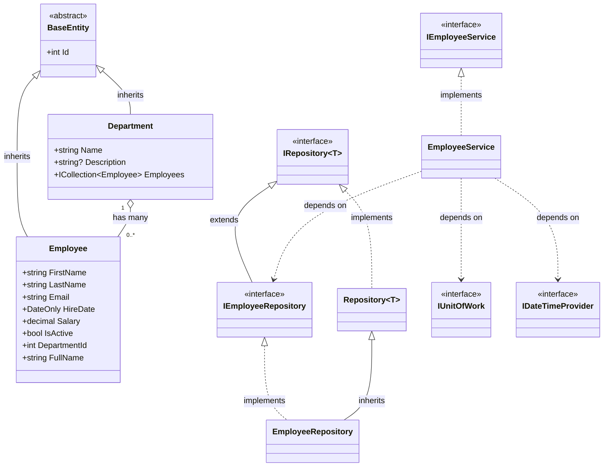

# Class relationship diagram and SOLID (Week 1, Day 2)

## Class relationship diagram

Reading the diagram:
* **Inheritance** (`<|--`): `Employee` and `Department` share the `Id` key from `BaseEntity`.
* **Association** (`o--`): one department has many employees (navigation property + foreign key).
* **Interface implementation** (`<|..`): services and repositories are used through interfaces.
* **Dependency** (`..>`): `EmployeeService` is given its collaborators by constructor injection and only knows their interfaces.

## SOLID in this project

| Principle | Where it is applied |
|-----------|---------------------|
| **S**ingle responsibility | Each class has one reason to change. `EmployeeService` holds business rules, `EmployeeRepository` holds queries, `EmployeesController` handles HTTP, `TokenService` creates tokens. |
| **O**pen/closed | New behaviour is added by writing a new class instead of editing an old one. A different clock or user store is a new class implementing `IDateTimeProvider` or `IUserStore`; `EmployeeService` and `AuthService` do not change. |
| **L**iskov substitution | Anything implementing an interface can replace another without breaking callers. The tests swap `FakeEmployeeRepository` for the EF Core `EmployeeRepository` and the service behaves the same. |
| **I**nterface segregation | Interfaces are small and focused: `IUnitOfWork` only saves, `IDateTimeProvider` only tells the time, `ITokenService` only creates tokens. No class is forced to implement methods it does not use. |
| **D**ependency inversion | High-level code depends on abstractions. `EmployeeService` (Application layer) depends on `IEmployeeRepository`, which Application defines and Infrastructure implements, so the dependency arrows point inwards. |

## Composition over inheritance

Inheritance is used only for the shared key (`BaseEntity`) and for sharing generic CRUD code (`Repository<T>`).
Everything else is **composition**: `EmployeeService` *has* a repository, a unit of work and a clock, supplied through
its constructor, rather than *being* a kind of repository. Composition keeps classes loosely coupled and makes
them easy to test by passing in fakes.

## Interface vs abstract class (used here)

* `IEmployeeRepository` is an **interface**: a pure contract with no code, which any class can implement.
* `BaseEntity` is an **abstract class**: it holds shared state (`Id`) that child classes inherit, and cannot be created on its own.
